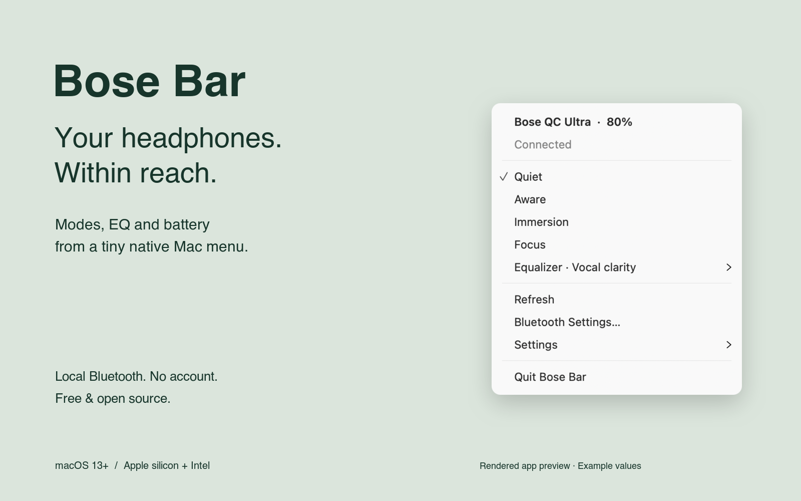
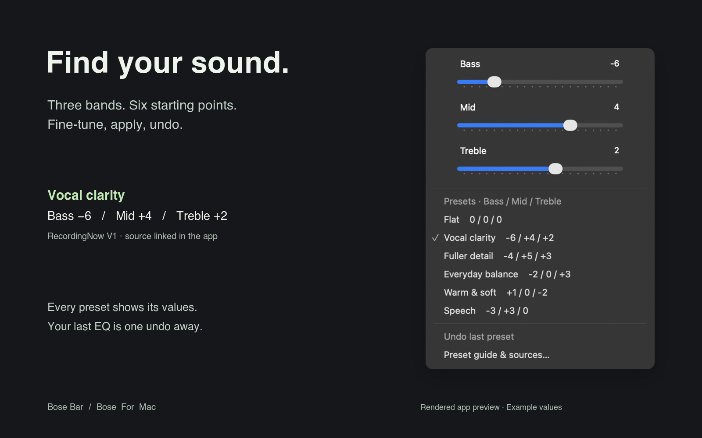
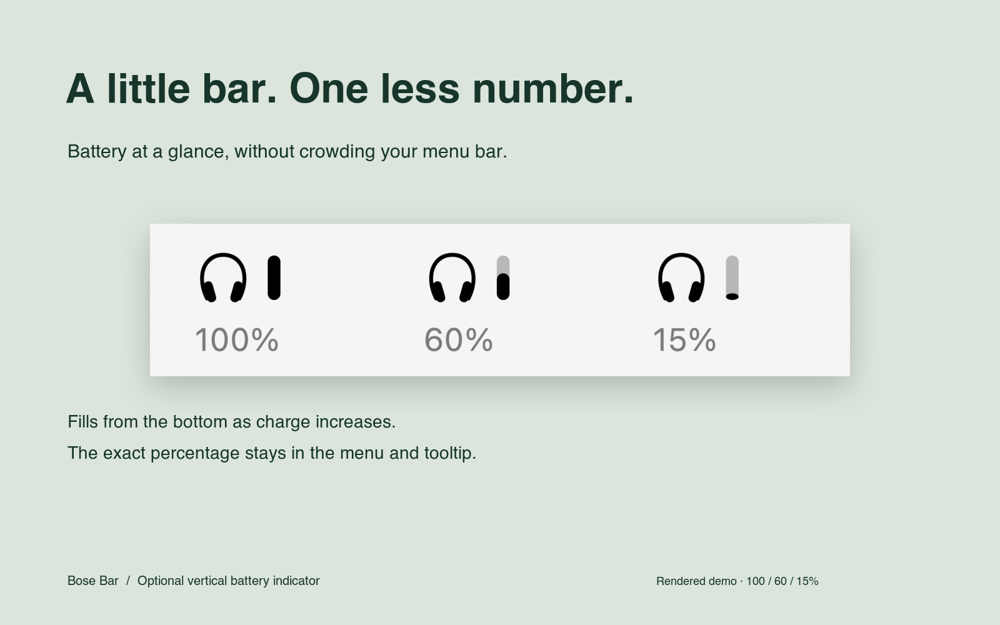

<div align="center">

# Bose Bar

**Your Bose headphones, one click away.**

A tiny native macOS menu bar app for listening modes, battery and EQ.

[](https://github.com/Twis06/Bose_For_Mac/releases/latest)


[](LICENSE)

[Download for Mac](https://github.com/Twis06/Bose_For_Mac/releases/latest/download/Bose-Bar-macOS.dmg) · [Quick install](#quick-install) · [EQ guide](docs/eq-presets.md) · [Report an issue](https://github.com/Twis06/Bose_For_Mac/issues)



</div>

## Small app. Useful controls.

- **Switch modes:** Quiet, Aware, Immersion and your configured custom modes, read from the headphones.
- **Glance at battery:** a narrow vertical bar beside the headphone icon. Exact percentage in the menu and tooltip.
- **Find your sound:** bass/mid/treble sliders, six EQ presets and one-step undo of the last preset.
- **Stay out of the way:** no Dock icon, browser runtime, Python environment, account, cloud service or app telemetry.
- **Make it yours:** optional launch at login and battery bar; remembered headphone selection; reconnect after sleep.

Built with Swift, AppKit and Apple's Bluetooth framework. No third-party runtime packages. The app talks directly to the headphones using the [bosectl](https://github.com/aaronsb/bosectl) project's BMAP protocol work.

## Install

**Requires macOS 13 or later.** The download is a universal app for Apple silicon and Intel.

1. [Download the latest DMG](https://github.com/Twis06/Bose_For_Mac/releases/latest/download/Bose-Bar-macOS.dmg).
2. Open it and drag **Bose Bar** to **Applications**.
3. Launch Bose Bar. Allow Bluetooth access if macOS asks.
4. Connect your QC Ultra in macOS Bluetooth Settings, then click the headphone icon in your menu bar.

**First launch:** this community build is ad-hoc signed, **not Apple-notarized**. If macOS blocks it, review the project, attempt to open it once, then use **System Settings → Privacy & Security → Open Anyway**. There is no need to disable Gatekeeper. Release downloads include [SHA-256 checksums](https://github.com/Twis06/Bose_For_Mac/releases/latest/download/SHA256SUMS).

### Quick install

This downloads the latest universal ZIP, verifies its SHA-256 checksum and signature, and installs to `~/Applications`. It does not require Homebrew, Xcode or sudo.

```sh
curl -fsSL https://raw.githubusercontent.com/Twis06/Bose_For_Mac/main/install.sh | bash
```

Prefer to inspect the script first? [Read install.sh](install.sh), or download the [ZIP](https://github.com/Twis06/Bose_For_Mac/releases/latest/download/Bose-Bar-macOS.zip) manually. When updating, the installer retains your old app as `~/Applications/Bose Bar.previous.app`; move or delete that backup before running the installer again. Enable **Settings → Launch at login** after installing to your permanent location.

## EQ presets



All values are **bass / mid / treble** in Bose slider steps. They are starting points, not measured calibration profiles. Nothing is automatically applied on launch.

| Preset | Values | Source |
| :-- | :-- | :-- |
| Flat | `0 / 0 / 0` | Zeroed EQ |
| Vocal clarity | `−6 / +4 / +2` | RecordingNow V1 |
| Fuller detail | `−4 / +5 / +3` | RecordingNow V2 |
| Everyday balance | `−2 / 0 / +3` | Tom’s Guide |
| Warm & soft | `+1 / 0 / −2` | Bose Bar starting point |
| Speech | `−3 / +3 / 0` | Bose Bar starting point |

[Read the preset guide and original sources →](docs/eq-presets.md)

Each change is checked against the headphones' reported values. If a multi-band preset fails, the app tries to restore the previous EQ and reports whether it succeeded. **Undo last preset** is available until you switch or disconnect headphones.

## Battery, without the clutter



The bar fills from bottom to top. An unknown reading uses a small dash; a disconnected device dims the icon. Toggle it in **Settings → Show battery bar**. The exact percentage remains in the menu and tooltip. Battery is checked roughly every 90 seconds, with other values refreshed when opening the menu.

*The images above are rendered previews of the app's native controls using example data, not live desktop captures. [Reproduce the artwork](docs/DEVELOPMENT.md#demo-artwork).*

## Headphone support

| Model | Status | Controls |
| :-- | :-- | :-- |
| **QC Ultra Headphones, original** | Hardware-verified on firmware 1.6.7 | Battery, factory/custom listening modes, three-band EQ |
| **QC Ultra Headphones, 2nd Gen** | Implemented; not hardware-verified here | Same core controls; live ANC/wind/immersive controls only when the device returns the supported format |
| Other Bose models / earbuds | Not verified | Please open a device-support issue before assuming compatibility |

On the original Ultra, noise cancellation is controlled through Quiet, Aware and custom listening modes. The separate live audio-settings command used by Ultra 2 is unsupported on the tested firmware and stays hidden. This app does not create or rename headphone modes, control playback or replace the audio connection.

## Troubleshooting

| Symptom | Try this |
| :-- | :-- |
| No headphones shown | Pair them in macOS Bluetooth Settings first. With more than one pair, use **Headphones** in the menu. |
| Audio works but controls don't | Choose **Retry connection**. macOS can report inaccurate connection flags; the app remembers your selected headphones. |
| Connection times out | Close another Bose control app, reconnect in Bluetooth Settings, then retry. |
| Bluetooth access denied | Enable Bose Bar in **System Settings → Privacy & Security → Bluetooth**. |
| A preset fails | Reconnect, refresh and inspect all three values. The error explains whether the old EQ was restored. |
| Login startup does not work | Keep the app in Applications, then toggle **Settings → Launch at login** again. macOS may require approval in Login Items. |

To uninstall, turn off **Launch at login**, quit Bose Bar and move the app to Trash. Preferences are stored locally in macOS UserDefaults; no account needs deleting. [Bug reports](https://github.com/Twis06/Bose_For_Mac/issues/new/choose) should omit device addresses and serial numbers.

## Build from source

```sh
git clone https://github.com/Twis06/Bose_For_Mac.git
cd Bose_For_Mac
./test.sh
./build.sh
open 'build/Bose Bar.app'
```

Requires Apple's Command Line Tools. Use `./build.sh --universal` for both architectures. [Development, tests, image generation and release instructions →](docs/DEVELOPMENT.md)

## Credits & license

- [aaronsb/bosectl](https://github.com/aaronsb/bosectl) — BMAP research, framing, payloads and macOS transport approach. The original MIT notice is retained.
- [Screenshot.rocks](https://github.com/daveearley/screenshot.rocks) — open-source Sage/Midnight demo styling, with its MIT notice included.
- [ImageMagick](https://github.com/ImageMagick/ImageMagick) — reproducible artwork composition; development-only.
- EQ authors are linked in the [preset guide](docs/eq-presets.md).

[MIT](LICENSE) · [Third-party notices](NOTICE) · [Contributing](CONTRIBUTING.md)

An independent community project. Not affiliated with or endorsed by Bose or Apple. Bose and QuietComfort are trademarks of their respective owners.
